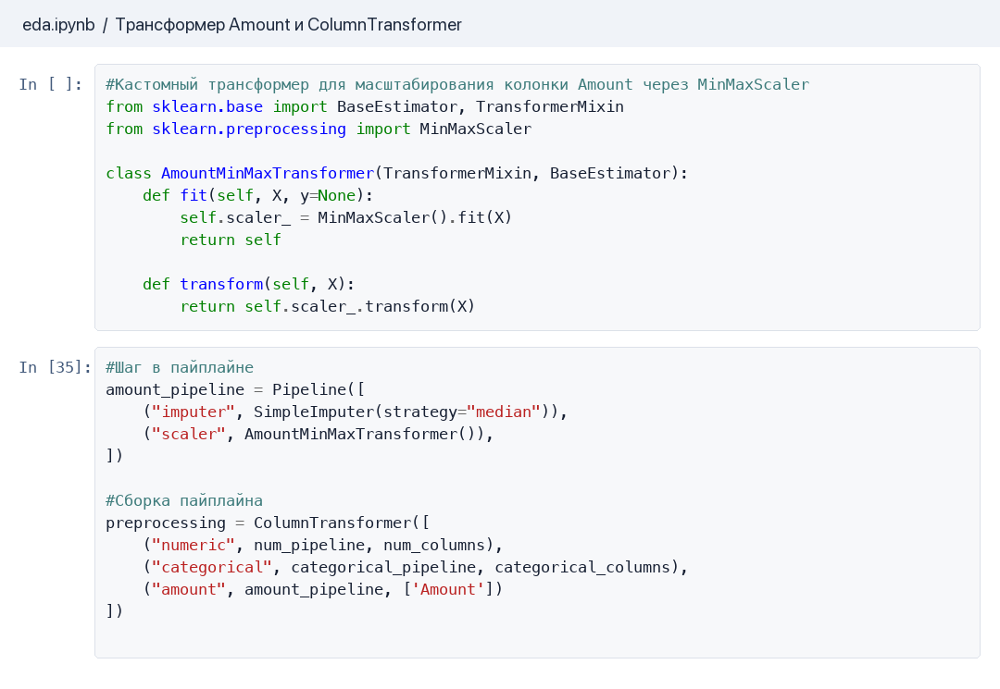
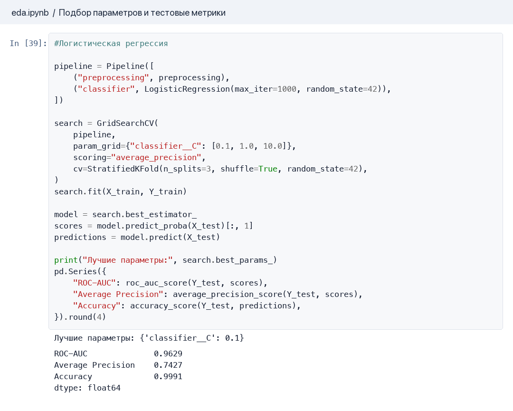

# Лабораторная работа № 1. Обнаружение мошеннических транзакций

Цель работы — построить в Jupyter Notebook воспроизводимый пайплайн предобработки и бинарной классификации. Используется [Credit Card Fraud Detection](https://www.kaggle.com/datasets/mlg-ulb/creditcardfraud). В наборе 284 807 транзакций, из них 492 мошеннические (0,17%). Целевая переменная — `Class`, где `1` означает мошенничество.

## Ход работы

1. Данные загружены через pandas в [notebooks/eda.ipynb](notebooks/eda.ipynb) и разделены на обучающую и тестовую выборки в пропорции 80/20 с `stratify=Y` и `random_state=42`.
2. В исходном CSV пропусков нет. После разбиения в каждой выборке примерно 10% значений каждой из колонок `V1` и `V2` заменены на `NaN`.
3. В `ColumnTransformer` числовые признаки обрабатываются медианной импутацией и `StandardScaler`. Для `Amount` выделена отдельная ветка с медианной импутацией и кастомным `AmountMinMaxTransformer` на основе `MinMaxScaler`. Категориальная ветка с импутацией модой и `OneHotEncoder(handle_unknown="ignore")` получает пустой список колонок.
4. Пайплайн завершает логистическая регрессия. `GridSearchCV` с тремя стратифицированными фолдами выбирает `C` по Average Precision на обучающей выборке. Лучшее значение — `C=0.1`. Обученный пайплайн сохранён через `joblib` в `models/fraud_pipeline.joblib`.

## Результаты

| Метрика на тестовой выборке | Значение |
|---|---:|
| ROC-AUC | 0.9629 |
| Average Precision | 0.7427 |
| Accuracy | 0.9991 |

Основная метрика — Average Precision. При доле мошенничества 0,17% предсказание класса `0` для всех операций даёт accuracy около 99,83%, поэтому по одной accuracy трудно оценить качество обнаружения мошенничества.

## Запуск

1. Установите зависимости командой `python -m pip install -r requirements.txt`.
2. Скачайте `creditcard.csv` по ссылке выше и поместите его в `data/raw`. Указатель DVC — `data/raw/creditcard.csv.dvc`.
3. Запустите `jupyter lab` из корня проекта. В `notebooks/eda.ipynb` в ячейках чтения CSV и сохранения модели укажите пути для своей машины и выполните ячейки сверху вниз.
